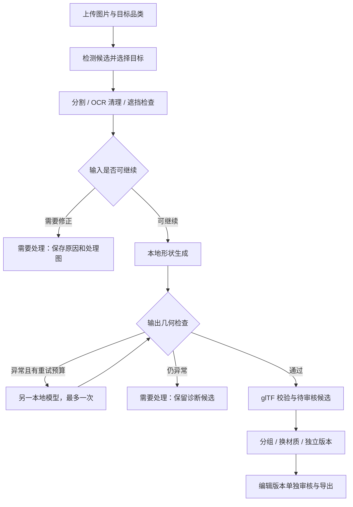

# img_to3D 项目阶段交付与详细验收报告

日期：2026-11-11。工作目录：`D:\Documents\MiniLab\img_to3D`。

本次完成的是可运行的本地单人工作台：图片选择、主体处理、输入拦截、本地生成、输出几何检查、有限返工、人工审核、版本化分组与材质编辑、GLB 导出。已经运行真实图片和真实模型，并保存失败结果。**本次自动重建测试仍没有通过完整商品还原验收的样本；不改变历史手工作品和用户审核记录。**

[打开工作台](http://127.0.0.1:8000) · [图像与证据总览](../experiments/project_delivery_20261111/index.html) · [机器可读验收](../experiments/project_delivery_20261111/acceptance.json)


## 1. 本次新增交付

沿用的前序工作：已盘点 `images/` 中 884 张图片；之前固定 11 例（5 张白底、6 张场景，含 1 张疑似渲染场景）完成图像与建模检查。输入清理阶段的结果为 5 例拦截、6 例继续生成。上述记录保存在旧报告中，本轮没有把它们重复宣称为 11 次新的神经生成。本轮新增的是 11 个历史 GLB 的离线输出检查、4 个真实工作台流程案例，以及实际模型上的编辑/导出验证。

| 能力 | 已实现的行为 | 边界 |
| --- | --- | --- |
| 输出几何检查 | 检查非有限/空网格、可疑薄片/低秩体积、特定品类方块退化、连通片及封闭性 | 启发式规则，不证明原图相似度、瓶口或实物尺寸 |
| 有限返工 | 异常时最多改用另一本地模型一次；保存两次模型、参数和日志 | 不重试输入遮挡问题，不调用付费服务，不无限循环 |
| 品类意图 | 可手动指定花瓶、桌子等，用于质检规则；保留不确定/其他选项 | 不改变图片选框，不调用该品类参数模板强行造型 |
| 已有部件选择 | 按当前 GLB 节点/primitive 列表选择，也支持点击模型拾取及选区外框 | 一张连续网格不会自动变成语义部件 |
| 连通片分组 | 保留所有面，把几何相连的部分归组，小片集中保留 | 连通片不是桌腿/坐垫等语义标签 |
| 空间区域分组 | 按 X/Y/Z 与百分比分界对面中心分组 | 不切割三角面，不封口，不是装配级实体拆分 |
| 整体/局部换材质 | 颜色、粗糙度、金属度、不透明度；支持替换与保留纹理染色 | 哑光/金属/塑料/织物/透明均为参数材质或近似效果 |
| 版本与恢复 | 每次编辑生成独立 GLB，支持查看历史、恢复原始和恢复历史为新版本 | 原始生成文件不覆盖；当前分组 ID 绑定版本 |
| 独立编辑审核 | 编辑版本可接受或退回，新编辑与恢复版本不继承旧审核 | 演示编辑版本保持未验收，没有伪造用户通过 |
| 导出 | 编辑 GLB 与编辑记录分别下载，原生成记录包继续保留 | 当前没有将编辑版自动发布到统一模型库 |

## 2. 当前流程和状态



`awaiting_input/local_input` 表示图片需要修改，尚未启动 3D。`awaiting_input/local_output` 表示生成过候选但输出异常，主模型下载不开放，可查看诊断候选。`awaiting_review` 只表示已得到通过技术规则的候选。编辑版本另存 `unreviewed/accepted/rejected`，与原任务审核分离。

## 3. 本轮真实生成与返工

| 案例 | 实际执行 | 最终状态 | 结论 |
| --- | --- | --- | --- |
| 彩绘花瓶，开启重试 | Hunyuan 被标记为横向厚度异常；重试 TripoSR 一次 | 待审核，实际来源为 TripoSR | 厚度增加，但表面粗糙、瓶口封闭，**未达到商品还原验收** |
| 圆桌对照 | Hunyuan 一次，几何检查通过 | 待审核 | 正常薄桌面与分离支撑没有被整体薄片规则误拦 |
| 猫遮挡沙发 | 在输入检查处停止 | 需要处理，0 次形状尝试 | 输入问题未浪费重试，也未把方块作为新资产发布 |
| 彩绘花瓶，关闭重试 | Hunyuan 一次后被几何规则拦截 | 需要处理，主 GLB 返回 409 | 诊断候选仍可访问，未作为可用资产发布 |

任务入口：[花瓶有限返工](http://127.0.0.1:8000/?job=98b4389eb9e240cab5aa94934e089b6f)、[圆桌对照](http://127.0.0.1:8000/?job=b51be48468e54d0680a542174c0c873b)、[输入拦截](http://127.0.0.1:8000/?job=b0239ce41e444a9985f33b322cb92ec1)、[输出拦截](http://127.0.0.1:8000/?job=221e98bbff74424aa34df1a4625055f9)。

额外对首轮 11 个历史 GLB 做了离线规则筛查：本次标记彩绘花瓶、猫遮挡沙发方块及小盆栽剪影片 3 例。陈列柜粘连物品、玻璃桌楔块和插花瓶缺口并不能全部由当前几何规则发现，因此输入检查和人工外观核对仍保留。**这些是已知难例回归，不是独立测试集准确率。**

本机单次记录：花瓶两次生成及本地处理共 147.031 秒；圆桌本地处理 101.047 秒。数据含模型启动与检查等开销，不含全部排队/浏览器加载；CPU 渲染和编辑可能并行，不作为速度基准。各模型显存数字仍以 PyTorch 分配器为口径，不代表整卡占用。

## 4. 真实编辑验收

在实际生成的琴叶榕盆栽上完成测试，原始模型不是用于替代生成质量的合成夹具。

- 原模型有 1 个可编辑 primitive、338,358 个三角面。按高度分成 2 个区域后，整体换成绿色，再将下部区域改成棕色。两个区域材质保持独立。
- 恢复原始版本后，导出字节与原始 GLB 一致；恢复历史材质版本后，导出字节与该历史文件一致。
- 对最终编辑 GLB 核验了顶点位置、节点世界变换、三角面索引多重集合，均与原始模型一致。不是仅比较三角面数量。
- 实际连通片操作得到 6 个几何组，未将它们命名成语义部件；最终展示恢复到两个空间区域的材质版本。
- 已验证 3D 点击拾取、选区外框、刷新恢复、移动端无横向溢出、GLB 下载和编辑记录。
- 真实 TripoSR 彩色模型也做了验证：替换模式移除旧顶点色影响，染色模式保留顶点色，避免用户换色却仍被原预测颜色覆盖。
- 最终编辑 GLB 在 Blender 中再次导入并用自身材质渲染，未覆盖成灰模；glTF Validator 为 0 错误、0 警告。

[打开当前盆栽编辑示例](http://127.0.0.1:8000/?job=6eab9c5a4a9545febbfc0835fd89ee4e) · [固定导出 GLB](../experiments/asset_editor_20261111/final_edited_plant.glb) · [外部查看器渲染](../experiments/asset_editor_20261111/edited_materials_blender.png) · [几何保持证据](../experiments/asset_editor_20261111/geometry_preservation.json)

固定导出 SHA-256：`4b5c08f3170f8b67d4176ce6bd40aab68eba1dd89f45bd502881c47db414a928`。原始 GLB 为 8,115,916 字节，固定导出为 12,179,040 字节。分组增加索引，版本当前按完整文件保存，没有宣称轻量化。

编辑 Worker 的一次记录：区域分组 1.157 秒、局部换材质 0.360 秒，均不包含 API 文件校验和浏览器加载，不可当作端到端耗时保证。

## 5. 使用步骤

1. 在项目目录运行 `powershell -ExecutionPolicy Bypass -File .\start.ps1`，打开本地工作台。
2. 上传图片、选择目标。检查识别框；若品类错误，可手动指定目标品类用于几何检查。
3. 选择本地模型。默认允许几何异常时最多换一个本地模型重试；图片遮挡/低像素问题会先停下。
4. 得到候选后旋转查看。若要局部换材质，先选择已有部件；连续网格可展开“几何分组与拆分”，设置方向和分界位置。
5. 在编辑范围选择整个模型或一个分组，选颜色与材质参数，保存独立版本。版本列表可查看与恢复历史。
6. 审核当前编辑版本，下载该编辑 GLB 和编辑记录。页面的原始生成记录包对应原始模型，不会暗中替换成编辑版。

## 6. 软件验证

| 检查 | 结果 | 性质 |
| --- | ---: | --- |
| API 与状态/契约测试 | 30 通过 | 包括输出拦截、诊断访问、版本冲突、独立审核与恢复 |
| 输入清理规则 | 11 通过 | 包括尺寸引线、文字保护与正常孔洞 |
| 原预处理回归 | 4 通过 | 浅色部件、透明通道、顶点色、Windows 原子写入 |
| 输出几何规则 | 6 通过 | 旋转薄片、正常薄桌面、柜子与沙发方块区别等 |
| 资产分组保持 | 3 通过 | 顶点/面数保持、共享节点不串色、正常立方体不拆成六个假部件 |
| 合计 | **54 通过** | 合成夹具只证明软件契约，不证明照片还原能力 |
| 前端构建 | 通过 | 仍有约 810 kB 主包的体积提示，未做生产级性能承诺 |
| 真实浏览器及文件 | 通过 | 全局/局部材质、历史恢复、刷新、移动端、点击拾取、外部 GLB 查看 |

## 7. 本次修正的工程问题

复现软件检查可使用下列命令；真实浏览器脚本会在测试任务上创建独立编辑版本，不是只读检查：

```powershell
.\.venv\Scripts\python.exe -m unittest discover -s tests -v
.\.venv-preflight\Scripts\python.exe scripts/test_input_preflight.py
.\.venv-3d\Scripts\python.exe scripts/test_local3d_preprocess.py
.\.venv-hunyuan\Scripts\python.exe scripts/test_output_geometry.py
.\.venv-hunyuan\Scripts\python.exe scripts/test_asset_grouping.py
npm run build
node scripts/test_asset_editor_workflow.mjs
```

1. 避免把格式合法当成几何可用；失败候选与主模型下载分开。
2. 返工次数有限，输入拦截不进入重试；实际成功模型与纹理来源如实记录。
3. 修改共享 mesh 的一个节点前先隔离，避免其他实例被一起改色。
4. 按世界坐标处理空间分界，保留原三角面和节点变换；未被分开的已有部件保留其名称。
5. 替换材质时处理 TripoSR 的顶点色，染色时则保留，避免两种意图混淆。
6. 当前预览、下载链接和显示的部件/面数/文件大小对应当前编辑版本。
7. 原模型审核与编辑审核分开，恢复为新版本不继承旧批准；并发编辑使用版本冲突保护。
8. 原模型、前次失败、返工候选和历史编辑文件分别保存。

## 8. 仍未解决的质量边界

- 单图无法证明背面、内部结构和真实尺寸；本轮没有制造准确率或尺寸误差数据。
- 当前规则无法识别所有商品结构错误，尤其瓶口、玻璃、反射、精细文字和软包结构。
- 遮挡处理仍是识别与拦截，没有自动补全真实产品结构；需要无遮挡图或额外视图。
- 区域/连通片分组不是语义拆分、实体切割、装配件或可打印封闭零件。
- 参数材质与透明近似不等于真实布料、木纹、石材扫描贴图或折射玻璃。改变材质不会补出缺失柜内几何。
- 编辑版本的独立审核已实现；没有替用户把当前演示资产标成已接受。
- 多目标场景仍须检查所选实例，单纯指定“花瓶”不会自动把选框从桌子移过去。

## 9. 后续部件与材质功能的实现顺序

| 顺序 | 工作 | 前置条件与验收门槛 |
| --- | --- | --- |
| 1 | 连体网格的精细面选、刷选及分组重命名 | 稳定部件 UUID、父子关系；选择/撤销可复现，面集合无丢失 |
| 2 | 语义部件拆分 | 先建立真实标注样本，区分桌腿、桌面、靠背等；自动结果允许人工纠正，不拿连通片数量当语义准确率 |
| 3 | 真实 PBR 材质库与纹理上传 | 来源、单位、颜色空间、UV/三平面映射/烘焙方案；导出到 Blender 后比例与方向一致 |
| 4 | 局部纹理和整体材质替换完善 | 部件边界、UV 接缝、贴图平铺、粗糙度/法线通道独立管理；保留原纹理与版本 |
| 5 | 部件替换与装配 | 独立节点变换、锚点、尺度与朝向；替换后不漂移，材质槽和附件关联可恢复 |
| 6 | 输出轻量化与 LOD | 在几何可用后减少面数和文件大小；细腿、孔洞、材质边界与 UV 不被损坏 |
| 7 | 多用户与批量服务 | 独立任务队列、GPU Worker、对象存储、权限、配额和版本保留；当前单机演示不宣称已经具备 |

这些是后续工作清单，不是已完成能力，也没有编造开发工期或未执行的测试结果。

## 10. 代码、数据与运行维护

- 输出检查：`scripts/analyze_geometry.py`、`services/api/output_quality.py`、`services/api/local3d.py`、`services/api/pipeline.py`。
- 编辑：`services/api/glb_document.py`、`services/api/asset_editor.py`、`scripts/edit_asset.py`、`apps/web/src/AssetEditor.tsx`、`apps/web/src/Viewer.tsx`。
- 几何诊断：`.data/jobs/<id>/attempts/`；编辑版本：`.data/jobs/<id>/assets/<version>/`，附请求、manifest 和操作日志。
- 真实验证：`experiments/output_quality_20261111/`、`experiments/asset_editor_20261111/`；本报告证据索引：`experiments/project_delivery_20261111/acceptance.json`。
- 核心接口：`GET /api/jobs/<id>/asset`、`POST /api/jobs/<id>/asset/versions`、`POST /api/jobs/<id>/assets/<version>/review`、`GET /api/jobs/<id>/assets/<version>/model.glb`。
- 运行依赖沿用独立 venv：API、目标检测、SAM、输入清理、TripoSR、Hunyuan 分开；商品图片和推理保留在本机。
- 当前是 localhost、SQLite、单 Uvicorn、共享 GPU 锁的单人工作台；未部署公网、多租户或商业云账号联调。
- 每个编辑版本当前保存完整 GLB，会增加磁盘占用；128 MiB 编辑文件上限明确报错，版本压缩/归档与保留策略待后续实现。

本轮所有结果以实际任务、哈希、模型与截图为依据。可继续开发和试用，但完整商品级重建仍需要进一步改善与验证。
