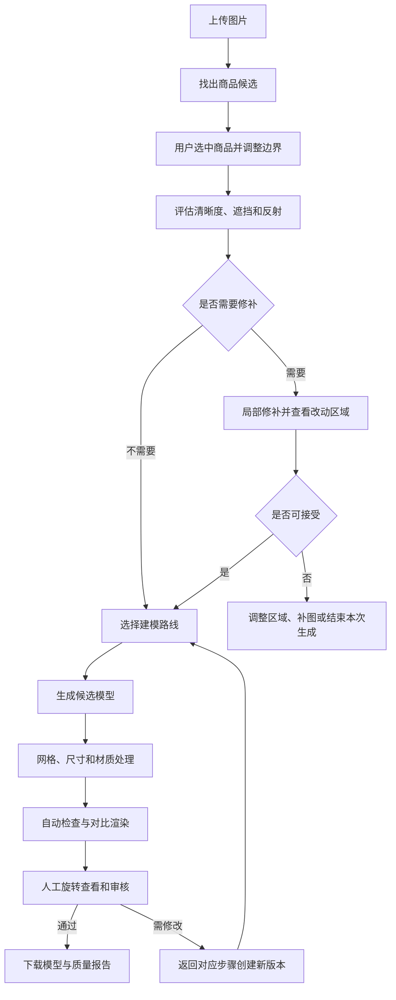

# 家具与家居商品 img to 3D：完整项目方案

设计日期：2026-11-10。本文描述目标产品和开发范围，不代表相关能力已经实现。

## 1. 项目定位与边界

将“从一张图片生成模型”定义为一个可审核的商品资产生产流程：用户上传白底图或场景图，指定一件商品，系统生成可旋转查看、具有合理结构和材质的 3D 展示模型，并明确哪些信息来自图片、哪些来自用户、哪些来自推测。

第一阶段以电商展示、商品目录和搭配预览为目标。不把单张图片生成的网格承诺为加工图、工程 CAD、装配结构或经过验证的测量模型。

### 三种输入场景

| 输入 | 必需交互 | 输出边界 |
| --- | --- | --- |
| 白底单件商品 | 自动提出目标，用户可修改 | 一件商品的独立模型 |
| 背景杂乱但主体明确 | 点击/框选目标，确认边界 | 去掉背景与不属于商品的物体后生成模型 |
| 同时存在多件家具 | 先选中一件；后续可增加逐件处理 | 第一版仍是一件商品；不推断整间房屋布局 |

单图中的全屋重建涉及尺度、物体相互遮挡和相机位姿等额外问题，应作为后续独立产品能力。

### 最少输入与可选补充

- 必需：一张图片。出现多个候选商品时，用户必须选择目标，不能默认取最大的物体。
- 建议：商品类别、需要保留的配件、已知尺寸及单位。
- 可选：同一 SKU 的其他角度图片、尺寸图、材质扫描、logo 原稿。
- 尺寸和多图均不设为生成展示预览的前置条件；缺失的信息在结果中明确标识。

### 单图的四个限制

1. **背面与遮挡区域不可直接观测。** 补全可以提高外观完整性，但属于推断。
2. **真实尺度不确定。** 没有可靠尺寸或标定参照时，不能从照片确定实际米制尺寸。
3. **材质和光照耦合。** 图片中的深浅可能是颜色，也可能是阴影或反射。
4. **精确结构不确定。** 接缝、孔洞、板厚和连接方式可能无法辨认；不能靠生成结果证明实物结构。

据此把质量分成独立的三部分：几何可用性、外观可信度、尺寸校准状态。不要用一个“相似度 95%”掩盖这些差别。

## 2. 用户操作流程



用户可以先得到低成本候选，确认结构后再执行耗时的纹理与精细化步骤。提供这类分阶段能力的后端优先采用；没有该能力的后端按整次生成预算处理。

### 首版界面

| 页面 | 用户完成的事情 |
| --- | --- |
| 项目/任务列表 | 查看处理进度、失败原因、待审核任务和历史版本 |
| 上传与目标选择 | 选中家具，确认类别、保留配件和可选尺寸 |
| 图片准备 | 对照原图查看抠图、修补和镜面区域，修改边界 |
| 生成与结果审核 | 旋转模型、切换固定视角、查看尺寸状态和质量报告 |
| 下载 | 取得已审核资产，或主动下载带未审核标识的草稿 |

生成失败应说明具体原因，并给出能执行的下一步，例如“目标被大面积遮挡，建议补一张同一商品侧面图”。不要把所有失败统一显示为“请稍后重试”。

## 3. 处理流程

### 阶段 A：收图、识别目标与建立证据

1. 校验文件格式、体积、解码后像素数；按 EXIF 方向显示，保存不可变原图。
2. 获取候选物体框、可见区域掩码、粗分类、清晰度和遮挡风险。
3. 用户选择目标并明确“属于商品的部件”。靠垫、灯罩、把手不应因命中杂物词表而误删。
4. 记录目标在原图中的位置、裁剪变换、原始分辨率；后续比较能够映射回原图。
5. 有补充图片时，先确认属于同一 SKU、颜色、配置和开合状态，再参与建模。

不要只通过“猫、狗、书、植物”等固定词表决定删除内容。先明确商品，再判断其他可见物体与商品的关系：背景、遮挡物、配件或商品自身部件。

#### 尺寸信息

OCR 仅产生候选尺寸，必须保留文本框、原文、单位和其对应的部位。区分外包装尺寸、展开尺寸、坐高和整件商品尺寸；不明确时要求用户确认。

图片、OCR、厂家资料和用户输入之间存在冲突时，保留冲突记录，不静默覆盖。用户确认的尺寸优先于未经确认的识别结果。

### 阶段 B：图片准备与必要修补

分开维护以下图层：商品可见区域、推测的完整轮廓、遮挡物、镜面区域、透明区域和 AI 修改区域。可见掩码不等于完整商品轮廓。

| 情况 | 默认处理 | 复核重点 |
| --- | --- | --- |
| 无遮挡白底图 | 裁剪、抠图、规范输入 | 细腿、孔洞和白色边缘是否被误删 |
| 杂物只在商品外部 | 删除背景即可 | 不需要为了删除背景杂物进行生成式修补 |
| 杂物挡住商品局部 | 只修补必要区域，保留修改掩码 | 缝线、板边、支腿、孔洞是否改变 |
| 商品被画面裁断或大面积遮挡 | 提示补图；也可明确选择仅生成概念预览 | 不自动声称可以准确恢复 |
| 强镜面 | 识别镜面和镜框，几何输入中弱化倒影 | 倒影不能进入几何或底色贴图 |
| 透明玻璃 | 单独保留边界、厚度线索和透射区域 | 不能简单把玻璃变成灰色实心板 |

**镜子、透明玻璃、金属不能共用一种处理。** 镜子主要保留外形和镜框；玻璃还要处理背后可见结构与玻璃本身的区别；高反光金属需要把环境反射与自身轮廓分开。

为几何生成准备一张规范图；为材质准备原始可见区域及真实材质素材。这两类输入可以不同。用于消除倒影的灰色占位图，不直接成为最终底色贴图。

修补后必须检查未授权区域是否也发生变化。默认将模型输出与原图按局部掩码合成，只允许修改指定区域，并处理必要的边界过渡。记录模型、版本、提示词、掩码和修改区域，不覆盖原图。

重度遮挡风险不能只用分割框面积计算：遮挡物的完整轮廓不等于被遮住的商品表面。没有真实完整轮廓时，只报告风险等级和判断依据，不伪造精确“遮挡率”。

### 阶段 C：可选增强

- 清晰原图直接进入后续步骤，避免不必要的重绘。
- 仅在目标实际分辨率不足时做超分辨率；放大像素不代表恢复了真实雕花、文字或织物细节。
- 降噪和白平衡优先使用保守变换，多图之间尽量一致。
- 去阴影、去高光作为可选实验，检查是否损伤凹槽、接缝和边界。
- 商品颜色需要准确时，使用厂家色卡或校色拍摄；无法从任意电商照片保证色差。

原图负责提供可观测事实，增强图负责提高算法输入可用性。生成的细节不升级为事实证据。

### 阶段 D：建模分流

路线由“类别、结构、参数是否可确认、模板是否覆盖、输入风险”共同决定。识别出“柜子”并不意味着某个通用柜体模板一定适用。

| 路线 | 适用条件 | 输出特点 | 主要风险 |
| --- | --- | --- | --- |
| 参数模板 | 桌几、开放架、简单柜体等；结构匹配且关键参数可约束 | 尺寸可控、部件清楚、易修改 | 模板不匹配时会生成错误结构 |
| AI 图生 3D | 软包、雕塑或暂时没有模板的形状 | 覆盖形状广、启动快 | 背面、薄结构、孔洞、细腿和贴图可能失真 |
| 混合建模 | 框架与软垫等部件可以可靠分开 | 框架参数化、局部采用 AI | 对齐、接缝、碰撞与重复表面难处理 |
| 人工协助 | 高价值、特殊结构或自动路线失败 | 可修正明确问题 | 时间与成本需要单独记录 |

参数模板必须具有：结构适用条件、参数单位、可选部件、最小/最大范围、比例与装配约束、UV 规则、材质槽、部件命名和回归样本。

图片理解模型可以输出结构化参数候选；通过 schema、范围和结构约束检查后再调用模板。不要直接执行模型生成的任意 Blender/Python 代码。

单图生成的多视角图可以作为生成先验，但同样是推测，不作为真实拍摄多视角参与精度证明。真实多视角也需要校验状态一致性和相机关系，不能简单把无关照片拼在一起。

**MVP 的生成顺序：** 在基准集上比较一条图生 3D 路线和少量模板；先把稳定路线接通。混合建模的自动拆件与装配放到后续阶段。

### 阶段 E：网格、尺寸与材质

#### 网格整理

统一坐标、朝向、落地位置与导出尺度；检查法线、退化面、悬浮碎片、明显穿插、重复表面和预期孔洞。小碎片可能是脚轮或把手，删除前结合部件语义和空间位置判断。

不要求所有展示网格都水密：薄玻璃、开放曲面与部分家具结构可能合理地存在边界。针对封闭实体检查水密性，避免为了“补洞”堵住商品本来存在的开孔。

减面后检查轮廓和薄结构；必要时提供不同细节级别。用实际浏览器加载结果验证，不能只检查 GLB 文件是否生成。

#### 真实尺寸

- 无已知尺度：允许旋转预览，标记“比例预览”，不启用真实尺寸 AR。
- 已知一个可靠外形尺寸：对可信几何做等比缩放；其余尺寸仍属于估计。
- 已知长宽高：模板按约束调整；AI 网格先检查比例差异，再决定能否缩放。
- 明显比例错误：返回生成或结构调整，不用任意非等比拉伸掩盖错误。
- 每个尺寸分别记录来源、是否确认、对应部位及误差；“包围盒吻合”不等于所有部件准确。

默认米制单位。允许用户输入厘米或毫米，但入库时统一换算，并保留原始输入。

#### 材质

优先级：已确认的商品材质原稿/扫描 > 可观测照片中的可靠区域 > 同类材质库 > AI 近似贴图。结果应记录使用了哪一级来源。

木纹要处理方向、接缝和重复比例；面料要记录纹样的实际重复尺寸；logo 和文字优先使用原稿贴花。金属度、粗糙度、法线与底色分别处理，避免把灯光或倒影烘焙到底色。

玻璃与镜面效果需要目标查看器支持。GLB 内的 PBR 金属材质通常依赖环境图提供反射；房间中准确的实时镜像还需要查看器的平面反射或光线追踪等能力，不能靠一个 GLB 文件自动实现。

### 阶段 F：自动检查、人工审核与交付

自动生成：匹配原图视角的对比图、正侧背视图、轮廓检查、部件检查、尺寸表和资源检查报告。

匹配原图视角需要估计焦距、透视与物体姿态；记录拟合结果和可靠程度。无法可靠匹配时改用标准视图并标记，不能把相机不一致误判为几何错误。

外观比较主要使用原图中真实可见且未被修改的区域；AI 修补区域单独展示。不能只拿生成模型与 AI 修补图比较，再宣称还原了原商品。

人工审核至少检查：目标正确、没有误删部件、正面相似、背面合理、孔洞/细腿没有缺失、材质可接受、尺寸状态清楚。修补过关键结构、强反光、透明材质或缺少尺度的结果应显示具体待确认事项。

### 交付包

```text
asset_<version>/
  model.glb
  preview_front.png
  preview_back.png
  comparison.png
  metadata.json
  quality_report.json
  README.txt
```

`metadata.json` 记录单位、尺寸依据、部件、材质来源、生成路线与资产版本；`quality_report.json` 记录自动检查、推测区域和审核结论。遮挡修补会改变证据，因此内部保留原图、掩码、编辑历史和运行信息。

模板路线可额外保存 `.blend` 源文件；AI 服务不一定能提供可编辑参数或可用部件结构，不能承诺所有路线都有相同编辑能力。

## 4. 人工参与如何最小化

| 节点 | 自动处理 | 人工处理 |
| --- | --- | --- |
| 上传与分类 | 校验、候选目标、粗分类 | 多目标时选择商品 |
| 抠图 | 初始边界与置信提示 | 边缘错误时点选或涂抹 |
| 修补 | 生成局部候选 | 关键结构受影响时确认 |
| 建模路线 | 根据覆盖范围提出建议 | 模板不匹配时换路线 |
| 尺寸 | OCR 与单位换算 | 确认部位、单位与冲突信息 |
| 检查 | 技术检查与对比图 | 最终外观审核 |

干净白底图的理想路径只有“上传、检查结果、下载”；复杂场景增加必要的选择与修正。人工审核不等于每个任务必须重做所有步骤。

后续只有在特定品类和输入条件的评测足够稳定后，才允许用户开启自动发布，并可追溯地保留规则版本。第一版完成生成不直接等于审核通过。

## 5. MVP 范围与里程碑

先完成单件资产闭环，再提高难图覆盖率。不同时开发整屋重建、大规模模板库和全自动混合装配。

| 阶段 | 交付内容 | 退出条件 |
| --- | --- | --- |
| M0：基准与选型 | 真实样本集、现有资产盘点、候选后端对比、预算基线 | 至少一条路线能在目标品类产出可接受结果；知道失败分布 |
| M1：可用闭环 | 单图上传、手工选目标、分割调整、一条 3D 后端、预览、下载、任务记录 | 从上传到审核下载完整跑通，失败可恢复，成本可追踪 |
| M2：结构与质量 | 2～3 类模板、尺寸录入、局部修补、材质替换、自动检查、版本与返工 | 品类覆盖有明确边界，质量报告可解释 |
| M3：受控试用 | 多用户隔离、配额、计费明细、后台管理、监控、备份、目标查看器验证 | 通过试用验收并能处理超时、取消、供应商异常 |
| 后续扩展 | 真实多图、批量 SKU、更多模板、混合建模、AR 和更多交付格式 | 每项能力单独评测后开放 |

建议首批模板选择简单桌/几、开放架、规则柜体。现有具体商品脚本用于提取可复用工具，不直接宣传成任意家具通用建模器。

**排期建议：** 若由 2～3 人投入、可使用商业 API、首版输入和品类范围受控，可先按 M0 1～2 周、M1 2～3 周、M2 2～4 周安排试验窗口。M3 的范围与排期在 M1 数据出来后确定。这是规划假设，不是完成时间承诺；自部署模型兼容、难例修复和模板数量可能明显增加工作量。

### 首版明确暂缓

- 从单图准确恢复整个房间及所有家具位置。
- 对任意新品类保证结构、背面、内部和真实尺寸准确。
- 全自动处理重度遮挡、复杂镜面和多层透明结构。
- 输出制造级 CAD、可装配工程图或无需处理的 3D 打印模型。
- 自动从整件 AI 网格恢复可靠的语义部件和参数化编辑历史。

## 6. 验收与评测

### 数据集设计

先收集约 30 个已知 SKU、合计约 100 张真实图片；尽量让同一 SKU 同时拥有白底图、场景图、不同视角与尺寸资料，以便比较处理前后和不同路线。

按主输入场景分成约 50 张干净图、30 张轻/中遮挡图、20 张困难图；额外打上玻璃、镜面、细腿、孔洞、文字、软包等可重叠标签。困难图用于检验能否识别风险与正确降级，不强求全部自动通过。

按 SKU 而非图片划分开发集与留出集，避免同款不同角度泄露。30 个 SKU 只足够做早期决策，不能证明已覆盖全部商品。

### 分开衡量四件事

| 指标 | 定义与用途 |
| --- | --- |
| 技术完成率 | 合法输入任务中，产出可解析可加载模型的比例 |
| 首次审核通过率 | 首个候选被审核接受的比例；按品类和场景拆分 |
| 最终交付率 | 在允许的预算和返工次数内得到可接受资产的比例 |
| 单件交付成本 | API、GPU、存储及人工等实际消耗 / 通过审核的资产数 |

同时统计 p50/p95 等待与处理耗时、人工分钟数、返工原因、预算超限次数。取消、拒绝输入和等待补图单独统计，并公布各指标的分母，不能通过丢弃难例提高成功率。

### 建议的首轮验收目标

以下用于启动评测，需在 M0 后根据业务价值和真实数据调整：

- 对明确纳入范围的干净图与轻度杂乱图，技术完成率目标 ≥95%。
- 同一范围内，首次人工审核通过率目标 ≥70%；按模板与 AI 路线分别报告。
- 通过输入、处理和导出记录能追踪每个资产的来源；关键修补区域必须可查看。
- 已确认外形尺寸的导出资产，包围盒与确认值的相对误差目标 ≤2%；它只验证外形约束与导出，不能证明真实结构精度。
- 默认网页展示档位以 ≤100k 三角面、≤20 MB GLB、1k～2k 纹理为优化起点；较复杂资产允许单独配置并提示。
- 交付模型通过 glTF 结构检查，并在选定的浏览器/设备组合实际加载；必须能正确显示默认视角、材质和旋转操作。
- 所有需要用户补充信息的任务都可暂停等待，不自动付费反复生成。

轮廓 IoU、感知相似度等自动分数可以辅助发现异常，不作为唯一放行依据。只在相机可靠匹配、可见区域标注合理时比较；没有真实 3D 扫描时，不报告几何毫米精度。

### 必测失败场景

目标选错、背景误入模型、细腿被抠掉、猫/书遮挡关键结构、镜中倒影长成实体、玻璃变实心、文字变形、模型背面塌陷、单位混淆、API 超时后重复扣费、文件下载链接过期、取消后结果迟到、GLB 有文件但浏览器不能显示。

## 7. 成本与经营闭环

总成本 = 图像识别/分割 + 必要图片编辑 + 3D 生成 + 网格与材质处理 + 渲染 + 存储/流量 + 人工复核与返工。

不能只比较单次模型 API 的标价。较贵但首轮通过率高的路线，可能具有更低的单件交付成本。

- 生成前展示预计费用范围和预算上限；实际收费按后端回执记录。
- 默认只生成一个候选；追加候选或改路线需要在已授权预算内。
- 默认不为合成多视图、超分、精细贴图和多轮修补全部付费。
- 对确定性或可复用的处理缓存；不同 seed 的生成候选不能误当成同一结果。
- 达到预算上限立即暂停后续付费步骤；失败重试同样计入预算。
- 技术重试与审美返工分开计数，便于判断是系统不稳定还是结果质量不足。

用户上传的商业图片若要交给第三方模型处理，应按产品约定选择允许的后端；本地保密模式下，不能在失败时自动切换到云服务。

## 8. 立刻可以开始的工作

1. 整理真实 SKU 样本与合格标准，给每张图标出目标、结构难点和尺寸依据。
2. 对同一批图比较“直接生成”和“分割后生成”，先验证图片清理是否实际提升交付率。
3. 接通一条图生 3D 后端和现有 Blender 导出链路，产出可审核的完整任务记录。
4. 抽取现有脚本中的基础几何、材质、渲染与导出函数，再实现少量受约束模板。
5. 根据失败数据决定下一笔投入：分割修正、遮挡补全、模板覆盖、材质质量或人工效率。

第一轮应回答“哪些商品能以什么成本得到可接受的模型”，再决定扩大自动化范围。
