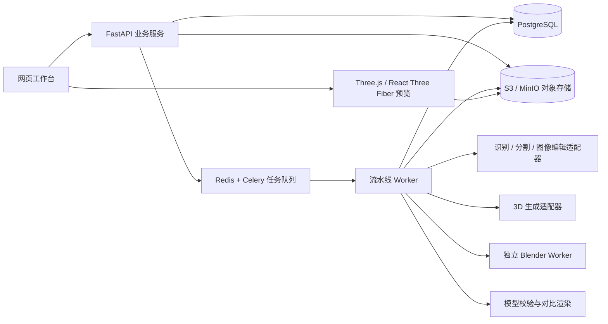

# img_to3D 技术设计

设计日期：2026-11-10。本文描述目标生产架构，目录、接口、状态和示例为目标契约。仓库已新增本地单用户 MVP，其实际接口以 `services/api/app.py` 和 `/openapi.json` 为准；实现差异见 [MVP 运行与限制](MVP_STATUS.md)。

## 1. 推荐架构



MVP 采用一个业务 API、一个数据库、一套对象存储和按任务类型区分的 Worker；不先拆成大量微服务。最小试验可以先采用商业生成 API，不预设必须购买 GPU。

前端建议 React + TypeScript；3D 预览采用 Three.js。FastAPI 负责输入、权限和业务状态，不在 HTTP 请求中直接执行长时间推理。PostgreSQL 是任务事实来源，Redis 只负责排队与临时协调。

本地模型服务建议使用独立的 Linux/WSL2 GPU 环境和容器；不同模型的 Python、CUDA、PyTorch 依赖分开固定。Blender 也独立运行，避免把其 Python 环境与推理环境混在一起。当前机器的命令行 Python 为 3.9.1，不能据此直接安装所有候选模型；例如本次核验的 SAM 2 仓库要求 Python ≥3.10。

Celery 消息可能重复投递，Worker 按至少一次投递设计；不能假设队列恰好执行一次。第三方任务轮询使用定时调度，不长期占用 GPU Worker。

## 2. 模块边界

| 模块 | 输入 | 输出 | 关键边界 |
| --- | --- | --- | --- |
| ingestion | 文件与可选商品信息 | 原图、元数据、图像变换 | 原图不可变 |
| perception | 原图/选区/提示点 | 候选框、可见掩码、类别与风险 | 不输出未经确认的真实尺寸 |
| preparation | 选定商品与处理策略 | 几何输入、材质证据、修改掩码 | 区分可见与推测区域 |
| routing | 类别、结构、已确认参数 | 模板/AI/人工路线及理由 | 允许拒绝不匹配模板 |
| generation | 规范图或受约束参数 | 网格/GLB 与后端回执 | 保留模型与请求版本 |
| normalization | 原始模型、已知尺寸 | 统一坐标、尺度与部件资产 | 不用拉伸掩盖结构错误 |
| materials | UV、材质区域与素材 | PBR 贴图与材质配置 | 来源可追踪 |
| qa | 模型、原图证据、检查规则 | 技术检查、对比图、待审核项 | 分开技术与外观结论 |
| delivery | 审核版本 | GLB、预览、元数据、质量报告 | 只交付指定资产版本 |

### 建议新增目录

```text
apps/web/                   网页工作台
services/api/               业务 API
workers/pipeline/           流水线编排、重试与预算
workers/blender/            模板、材质、标准化和渲染
providers/                  分割、图片编辑、3D 服务适配器
contracts/                  请求、参数、资产和检查结果的 schema
templates/                  版本化商品模板及适用条件
configs/                    处理策略与资源档位
evaluation/                 基准任务定义与结果汇总
docs/                       产品、技术与选型文档
```

最终交付资产集中到 `library/`；生成代码集中到 `modeling/`，建模纹理位于 `assets/`，运维与集成工具位于 `scripts/`。本地运行数据位于 `.data/`。生产数据转入对象存储，不把任务图片和大体积模型持续提交到代码仓库。

## 3. 数据模型

MVP 可以暂不建立庞大的商品信息系统，但必须区分一个 SKU、一张输入图、一次生成任务和一个资产版本。

| 实体 | 主要字段 |
| --- | --- |
| Project | 所属用户/组织、用途、数据处理策略 |
| Product | SKU、类别、配置、确认尺寸、真实材质引用；允许暂为空 |
| Image | 原图对象键、哈希、解码尺寸、EXIF、来源、变换与商品引用 |
| Target | 图片 ID、原图坐标框、可见掩码、用户选择与保留部件 |
| Job | 目标快照、配置版本、状态、预算、当前阶段、取消标记 |
| StepRun | 步骤、输入输出、尝试次数、租约、错误与时间 |
| ProviderRun | 提交凭据、外部任务 ID、提交状态、模型版本、费用与回执 |
| Artifact | 类型、对象键、内容哈希、父工件、创建步骤、修改区域 |
| AssetVersion | 模型、坐标、尺寸、材质、部件和运行来源 |
| Review | 资产版本、检查项、接受/拒绝/待确认、审核人、理由与时间 |

多用户时每个实体带 `tenant_id` 或等价所有者字段；对象存储键和访问策略也按所有者隔离。审核结果绑定资产版本，不能复用到修改后的模型上。

### 任务请求示例

本例故意保留未知尺寸。仅确认了宽度，不代表深度和高度经过核准。

```json
{
  "image_id": "img_001",
  "target_id": "target_001",
  "product_id": null,
  "purpose": "web_product_preview",
  "dimensions": {
    "width": {
      "value_m": 0.8,
      "source": "user",
      "confirmed": true,
      "scope": "overall"
    },
    "depth": null,
    "height": null
  },
  "processing": {
    "route": "auto",
    "allow_inpainting": true,
    "allow_third_party_processing": true,
    "candidate_count": 1,
    "quality_profile": "web_standard"
  },
  "budget": {
    "currency": "CNY",
    "max_amount": 30,
    "max_paid_generation_attempts": 1
  }
}
```

预算中的 30 元仅说明字段格式，不是任何模型服务的价格估计。API 必须校验合理尺寸、金额、候选数与租户配额。OCR 原始读数另存，不直接填入已确认参数。

### 资产质量报告示例

```json
{
  "schema_version": "1.0",
  "asset_version_id": "asset_v001",
  "units": "meter",
  "coordinate_system": "gltf_y_up_right_handed",
  "scale_status": "one_dimension_calibrated",
  "ar_true_scale_ready": false,
  "checks": {
    "gltf_valid": true,
    "viewer_load": "pass",
    "visible_silhouette": "needs_review",
    "critical_parts": "needs_review",
    "dimension_constraints": "pass",
    "material_appearance": "needs_review"
  },
  "evidence": {
    "original_image_id": "img_001",
    "edit_mask_artifact_id": "artifact_edit_mask",
    "occlusion_risk": "medium",
    "hidden_surfaces": "inferred",
    "camera_alignment": "approximate"
  },
  "review_status": "pending"
}
```

“技术检查通过”与“审核通过”是两种状态。未知结果用 `unknown`、`not_applicable` 或待审核项表示，不能默认为通过。

## 4. 任务状态与流水线

### 外层任务状态

```text
queued → running → awaiting_review → completed
               ↘ awaiting_input → running
               ↘ failed
queued/running/awaiting_input/awaiting_review → cancelled
awaiting_review → running（预算允许的返工或下游处理）
```

`awaiting_input` 表示缺少选区、尺寸确认、预算或必要处理决定；`awaiting_review` 表示有具体图像或模型等待审核。另存 `current_stage` 与 `review_gate`，区分图片准备审核和最终模型审核。

`completed` 表示指定版本已通过交付审核。生成完成后模型可以预览，也允许显式下载草稿，但默认进入 `awaiting_review`。

### 内层阶段

```text
validate → select_target → segment → assess_input
         → prepare_image → [review_prepared_image]
         → route → generate_geometry → normalize_geometry
         → apply_materials → validate_asset → render_comparison
         → review_asset → package
```

可选阶段根据策略跳过，记录跳过原因。有些后端一次输出带材质模型，适配器可以合并生成与贴图步骤，但仍要说明材质来源与能力限制。

单个 StepRun 使用 `pending/running/succeeded/failed/skipped`。使用任务租约与心跳识别 Worker 中断，不用“最后更新时间较久”直接判定付费任务不存在。

### 中断、重试和付费幂等

1. API 用 `Idempotency-Key` 避免重复创建同一操作；数据库事务记录任务与待发送事件，再由 outbox 派发队列消息。
2. 本地步骤通过步骤 ID、输入哈希和配置版本判断是否已完成；输出先写临时对象，再提交工件记录。
3. 付费提交前记录请求意图和预算预留；在支持时向供应商传递稳定幂等键。
4. 收到外部任务 ID 后立即持久化；随后仅轮询该任务，Worker 重启不重新生成。
5. 若提交超时且无法确定供应商是否接受请求，将该次提交标为 `submission_unknown` 并核对供应商记录。供应商没有幂等或查询能力时，暂停而不是盲目重复扣费。
6. 仅对可恢复的技术错误执行带抖动的退避重试；默认最多 2 次，且受总时间与预算限制。超出限流、认证失败、输入错误使用不同策略。
7. “结果不好看”属于新候选或返工，不能伪装成免费技术重试。
8. 取消先禁止下游步骤；第三方支持取消时发起请求。不支持或已计费时如实结算，并隔离迟到结果，不能把取消任务重新标为完成。
9. 外部回调校验真实性与事件 ID，并与轮询更新使用相同的单调状态规则，防止重复与乱序回调覆盖终态。

预算预留与实际费用分开，使用供应商价格表/报价和回执完成结算。并行候选提交也必须原子预留预算，避免并发超支；任务失败并不代表供应商没有收费。

### 缓存与失效

缓存键至少包含：输入内容哈希、目标/掩码版本、模型与代码版本、参数、提示词、seed、坐标变换及处理策略。不同用户之间只在明确允许时共享可复用缓存。

- 仅换材质：复用几何，重新生成材质、检查与渲染。
- 修改尺寸：模板重新构建或重新校准，复查装配、UV 和所有下游结果。
- 修改目标或修补图：失效受影响的生成及后续步骤。
- 仅审核备注：不重新调用模型。

相同 seed 不保证跨服务版本或硬件完全一致；可靠复现依赖保存实际工件和完整运行来源。

## 5. API 草案

| 接口 | 用途 |
| --- | --- |
| `POST /v1/uploads` | 创建受限上传凭据 |
| `POST /v1/images` | 确认上传，进行解码与安全校验 |
| `POST /v1/images/{id}/analysis` | 创建候选目标分析任务 |
| `PUT /v1/images/{id}/targets/{target_id}` | 保存选区、掩码修改与保留部件 |
| `POST /v1/jobs` | 创建任务、冻结输入快照、验证预算 |
| `GET /v1/jobs/{id}` | 查询状态、当前阶段、待处理项与工件 |
| `GET /v1/jobs/{id}/events` | SSE 输出任务事件，支持断线后按游标继续 |
| `POST /v1/jobs/{id}/resume` | 提交缺失信息/处理决定，恢复执行 |
| `POST /v1/jobs/{id}/cancel` | 请求取消 |
| `POST /v1/jobs/{id}/revisions` | 创建关联父版本的修改任务 |
| `POST /v1/reviews` | 对指定图片准备结果或资产版本提交审核 |
| `GET /v1/assets/{id}/download` | 获取有时效的下载链接及审核状态 |

耗时接口返回 `202 + job_id`；最终结果通过查询或事件获得。错误包括稳定错误码、用户可读信息、可否重试和建议操作。

图片分析与生成分别建任务，避免在尚未选择目标时直接发起昂贵调用。下载、预览、修改和审核接口均检查归属权限。

## 6. 供应商适配器

图像分割、图像编辑和图生 3D 采用不同契约，不把所有模型包装成一个含糊的 `generate()`。

3D 适配器至少声明：

```text
capabilities(): 支持单图/多图、贴图、部件、取消、幂等、回调等能力
validate_input(): 校验格式、分辨率、背景、预算及数据策略
estimate(): 返回报价或价格范围，以及未知项
submit(): 返回外部任务 ID 或明确的提交不确定状态
poll(): 返回运行状态、进度来源、费用与错误
fetch_artifacts(): 下载并验证输出，生成内部工件引用
cancel(): 在后端支持时申请取消
```

不支持真实多图、可编辑部件、独立几何阶段或 PBR 输出的服务，应公开其限制。最终统一成内部资产契约，不能假设所有服务输出完全兼容。

API 密钥只在服务端管理。发给第三方的输入链接应受限且有足够有效期；到期后按安全策略重新签名，避免暴露整桶访问权限。

## 7. 模板与 Blender Worker

模板描述必须包含版本、结构匹配条件、参数 schema、约束、材质槽、输出部件规则和示例。

例如开放架模板不仅需要长宽高，还要层数、板厚、支撑方式、开放/封闭背板和脚型。识别不出的字段使用显式默认值并标记推测，不让模型随意填数字。

Blender Worker 接收经过校验的 JSON 配置，在固定脚本中构建资产。通过进程参数列表启动 Blender，避免把用户内容拼接为 shell 命令；每次任务使用独立临时目录、资源上限与超时。

内部 Blender 通常 Z 向上；GLB 导出采用 glTF 右手系、Y 向上、米制。固定转换位置并检查一次，防止服务返回的 GLB 被重复旋转或缩放。记录正面约定、包围盒、根节点变换和接地面。

导出前完成必要的程序材质烘焙、UV 和纹理整理。底色按 sRGB 处理，法线/粗糙度/金属度作为非颜色数据；纹理打包和扩展以目标查看器实测兼容性为准。

现有脚本抽取顺序：基础几何 → 材质构造 → 坐标/尺度工具 → 导出 → 预览渲染 → 单类参数模板。不要直接重写所有原型。

## 8. 资产检查与渲染

### 技术检查

- glTF Validator 结构校验、依赖资源完整、包围盒与数值有限。
- 法线、UV、材质槽、纹理色彩空间和明显破损网格。
- 三角面、纹理尺寸、材质数量和文件大小是否符合质量档位。
- 关键部件存在、穿插与碎片风险；结构检查按品类启用。
- 指定浏览器查看器实际加载和截图，包含玻璃与金属扩展兼容性。

### 对比检查

1. 用目标轮廓和结构线索拟合原图相机；记录相机矩阵与裁剪变换。
2. 渲染接近原图的视角，同时输出统一照明的标准视图。
3. 对真实可见、未修补区域计算辅助指标，其他区域显示为未知或需审核。
4. 相机拟合失败时降级为标准视角人工检查，不输出误导性的精确相似分数。

原图同角度比较主要验证可见外观；背面检查只能判断合理性，除非另有背面照片或真实模型。

## 9. 运行保障

### 必需控制

- 实际解码校验上传文件，限制解码像素与体积，预防压缩炸弹；纠正方向后再生成选区。
- MVP 优先直接上传；若开放远程 URL，限制协议、重定向、内网地址与响应体积，避免 SSRF。
- 解码、推理和 Blender 处理均设置进程/容器资源上限与超时；不执行用户或模型提供的任意脚本。
- 配置访问控制、最小化签名链接权限、数据保留和删除周期；日志不记录 API 密钥、完整签名 URL 或不必要的图片内容。
- 删除任务应处理派生工件与缓存；备份和第三方副本按相应保留约定处理并记录状态。

### 观测与恢复

记录每一步的排队、执行、供应商等待耗时、费用、错误、重试、输入/输出版本。前端只展示真实阶段，不根据时间伪造百分比。

监控任务积压、Worker 心跳、失败率、供应商超时、预算异常、存储增长和人工待审核数量。MVP 至少验证数据库备份恢复与中断任务恢复。

GPU 吞吐与模型耗时采用实际硬件、分辨率、生成配置实测。限并发、限候选数和租户配额优先于过早引入复杂的自动扩容。

## 10. 实施时的必要验证

优先验证高影响路径：预算不能并发超支、付费提交超时不会盲目重提、任务取消后的迟到结果不改变终态、用户之间无法访问对方工件、尺寸换算和坐标转换正确、修改上游结果会使旧审核失效。

建模与材质质量依赖固定样本的实际渲染与人工比较，不用只验证代码分支的单元测试替代。成功接入后端不代表商品还原质量达标。
